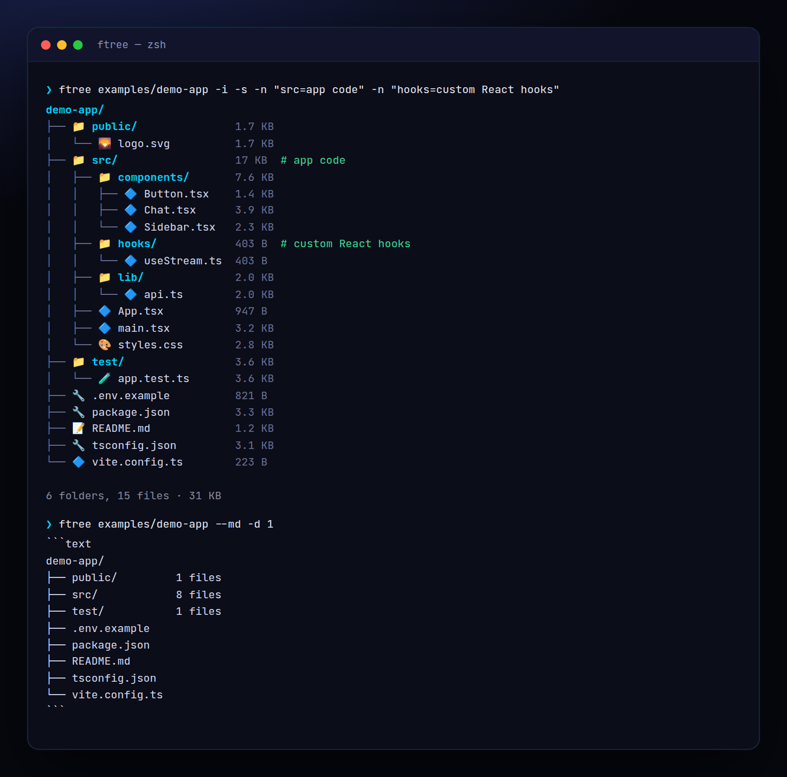

<!-- ═════════════ HEADER ═════════════ -->
<p align="center">
  
</p>

<p align="center">
  
</p>

<p align="center">
  <a href="https://github.com/krishyaa06/prism-folder-tree/actions/workflows/ci.yml"></a>
  
  
  <a href="LICENSE"></a>
</p>

<p align="center">
  
</p>


## ⚡ Overview

**Prism Folder Tree** (`ftree`) is `tree` built for developers who write READMEs. It respects `.gitignore` and skips `node_modules` / `dist` / `.git` automatically, puts folders first, can show icons and sizes, collapses deep folders into a file count, and lets you annotate entries (`-n "src=app code"`) with neatly aligned comments. `--md` gives you a ready-to-paste code block, and `--inject README.md` keeps the tree in your README up to date between `<!-- tree -->` markers.

## ✨ Features

- **.gitignore-aware**, skips `node_modules`, `dist`, `.next`, `.git`, venvs… by default
- Folders first, natural sort (`file2` before `file10`), or `--sort size`
- `--icons` and `--sizes` (folder sizes are totals); `--depth` collapses with `· 12 files`
- `--note "src=app code"` adds aligned `# comments` — perfect for docs
- `--md`, `--ascii`, `--json`, `--copy`; `--only "*.ts"` and `-e` filters
- `--inject README.md` rewrites the block between `<!-- tree -->` and `<!-- /tree -->`

## 🚀 Quick Start

```bash
# run without installing
npx github:krishyaa06/prism-folder-tree -i -s

# or install globally
npm install -g github:krishyaa06/prism-folder-tree
ftree --md -d 2
```

Requires Node.js 18.17+. No dependencies.

## 🛠️ Usage

```text
ftree [dir] [options]

  -d, --depth <n>        max depth (deeper folders collapse with a file count)
  -i, --icons            file-type icons
  -s, --sizes            file + folder sizes
      --sort <by>        name | size
  -e, --exclude <glob>   extra ignore patterns (repeatable)
      --only <glob>      only show matching files
  -n, --note <k=v>       annotate an entry (repeatable)
      --ascii            |-- instead of ├──
      --md               wrap in a ```text block
      --inject <file>    write into <!-- tree --> … <!-- /tree -->
  -c, --copy             copy to clipboard
      --json             nested JSON
      --no-gitignore     include gitignored files
```

### Keep your README tree fresh

Add markers to `README.md`:

```md
<!-- tree -->
<!-- /tree -->
```

Then run (or add to a pre-commit hook):

```bash
ftree --depth 2 -n "src=app code" --inject README.md
```

## 📁 Project Structure

```text
prism-folder-tree/
├── assets/
│   ├── logo.png
│   └── logo.svg
├── bin/
│   └── ftree.js   # CLI entry
├── examples/
│   └── demo-app/   # sample project
│       ├── public/
│       │   └── logo.svg
│       ├── src/
│       │   ├── components/
│       │   │   ├── Button.tsx
│       │   │   ├── Chat.tsx
│       │   │   └── Sidebar.tsx
│       │   ├── hooks/
│       │   │   └── useStream.ts
│       │   ├── lib/
│       │   │   └── api.ts
│       │   ├── App.tsx
│       │   ├── main.tsx
│       │   └── styles.css
│       ├── test/
│       │   └── app.test.ts
│       ├── .env.example
│       ├── README.md
│       ├── package.json
│       ├── tsconfig.json
│       └── vite.config.ts
├── src/
│   ├── index.js   # tree builder, renderer, injector
│   ├── ui.js   # colours, tables
│   └── walk.js   # gitignore-aware walker
├── test/
│   └── ftree.test.js
├── .gitignore
├── LICENSE
└── package.json
```

## 🧪 Tests

```bash
npm test
```

Tests use the built-in `node:test` runner, so there is nothing to install. CI runs them on Node 20 and 22.

## 🤝 Contributing

1. Fork the repo and create a branch: `git checkout -b feature/my-idea`
2. Make your change and add a test in `test/`
3. Run `npm test` and open a Pull Request

## 🔷 Part of Prism Protocol

Prism Folder Tree is one of the open-source tools built by [Prism Protocol](https://dc.gg/prismprotocol), a tech community where young builders learn, ship and compete together.

## 👤 Author

<table>
  <tr>
    <td align="center">
      <a href="https://github.com/krishyaa06"><br><b>Soumya Bhandare</b></a><br>
      <sub>Founder @ Prism Protocol</sub>
    </td>
    <td>
      <a href="https://dc.gg/prismprotocol"></a><br>
      <a href="https://instagram.com/prism_protocol_"></a><br>
      <a href="https://x.com/krishyaa06"></a>
    </td>
  </tr>
</table>

## 📄 License

Released under the [MIT License](LICENSE).

<p align="center">
  <b>If you like this project, consider giving it a ⭐</b><br>
  <sub>"Build. Create. Compete." · Made with ⚡ by Prism Protocol</sub>
</p>


